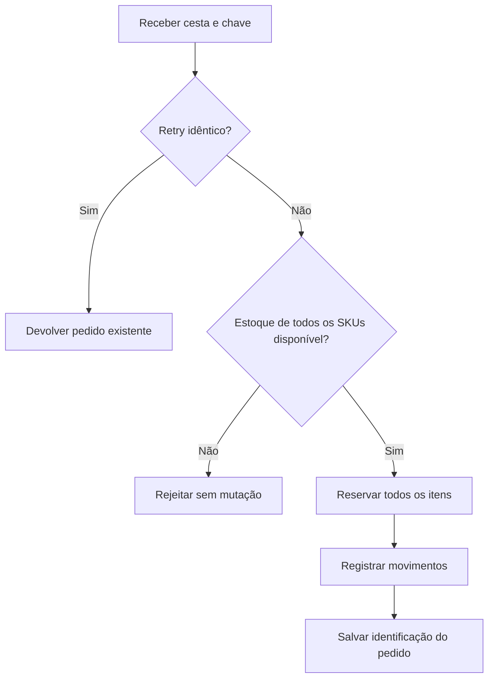

# Commerce Control

**Referência de controle de estoque, reserva de pedidos e conciliação de movimentos.**

O objetivo é demonstrar como preservar invariantes operacionais quando um pedido envolve vários itens: uma cesta não pode ser parcialmente reservada, uma chave de idempotência não pode ser reutilizada para pedidos diferentes e o saldo precisa ser explicável por movimentações.

Este repositório público inclui código executável de referência e uma vitrine interativa sintética. O backend privado, o histórico persistido e outros módulos comerciais são mantidos separadamente.

## Funcionalidades da versão pública

- `showcase/`: interface local com estoque e pedidos simulados.
- `reference/stock_reference.py`: reserva de múltiplos SKUs, cancelamento e transferências entre depósitos.
- Verificação de disponibilidade antes de qualquer mutação, para impedir reservas parciais.
- Controle de idempotência por hash do pedido e chave fornecida pelo chamador.
- Livro de movimentos com alterações no físico e no reservado.
- Conciliação entre saldo inicial, movimentações e saldo atual.
- Testes automatizados cobrindo recusa de estoque insuficiente, retry, cancelamento, transferência e adulteração de saldo.

## Execução no Windows

Requisitos: Python 3.11+; nenhum banco ou biblioteca de terceiros.

```powershell
py reference/stock_reference.py
py -m unittest discover -s tests -p "test_*.py" -v
py scripts/verify_showcase.py
py -m http.server 8080 --bind 127.0.0.1 -d showcase
```

Abra `http://127.0.0.1:8080/` e simule operações com os dados fictícios da interface. A interface estática não grava em um banco nem realiza venda real.

## Invariantes verificadas

| Situação | Regra |
| --- | --- |
| Reserva de dois SKUs, um indisponível | Nenhum SKU é reservado |
| Reenvio idêntico com mesma chave | Devolve o mesmo pedido, sem novos movimentos |
| Reenvio diferente com mesma chave | Recusado como conflito |
| Cancelamento de pedido reservado | Libera todas as quantidades da cesta |
| Transferência de depósito | Saída e entrada são refletidas no livro |
| Saldo alterado sem movimento | Detectado na conciliação |

O núcleo de referência utiliza inteiros para quantidades. Preços, imposto, pagamentos e faturamento não pertencem ao modelo publicado.

## Visão do processo



## Arquitetura e limites

```text
commerce-control/
├── showcase/                 Interface de demonstração
├── reference/stock_reference.py
├── tests/                    Testes da implementação de referência
├── scripts/verify_showcase.py
└── .github/workflows/ci.yml
```

Este exemplo usa memória local e **não é seguro para múltiplos processos concorrentes**. A propriedade de atomicidade aqui decorre de validar a cesta inteira antes de alterá-la; um sistema multiusuário requer transações, locks e isolamento adequados no banco.

A versão pública não implementa autenticação, autorização, emissão fiscal, estoque reservado por sessão externa, integração de pagamentos ou operações de ERP. Consulte [SECURITY.md](SECURITY.md), [NOTICE.md](NOTICE.md) e [docs/escopo.md](docs/escopo.md). Contato profissional: https://rafaelanalyst.com.br/.
